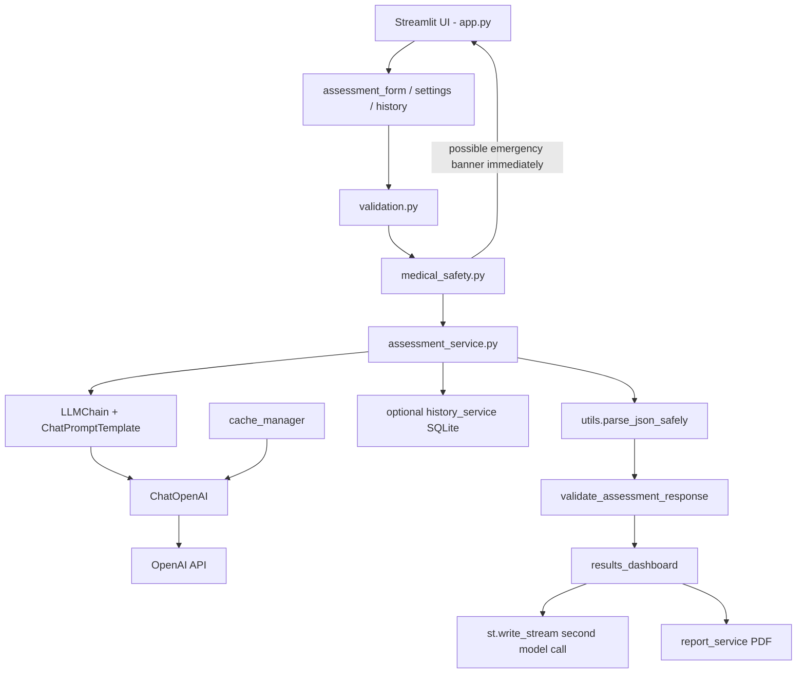

# MediGuide AI

**AI-Powered Medical Symptom Assessment and Patient Guidance Assistant**

*"Understand your symptoms. Explore your next steps."*

MediGuide AI is an **educational medical AI prototype**. A user can enter basic details and symptoms. The app uses **LangChain** and an **OpenAI chat model** to generate structured, safety-focused educational information that a person can discuss with a qualified healthcare professional.

This application **does not diagnose disease**. It is a university-style project, not a medical device.

---

## 1. Problem statement

People often search the internet when they feel unwell. Search results can be frightening, unstructured, or over-confident. Students also need a clear way to practise LangChain concepts (prompts, chains, caching, streaming, and JSON parsing) inside a real application.

MediGuide AI tackles both needs:

- It gives users a calm, organised place to describe symptoms.
- It returns educational information with uncertainty wording and next-step questions.
- It shows emergency warnings from local safety rules **before** any AI call.
- It demonstrates the LangChain ideas required in a BSCS assignment.

---

## 2. Objectives

- Collect patient-described details through a professional Streamlit form.
- Validate the input before contacting a model.
- Run deterministic emergency keyword checks with no API request.
- Use LangChain `ChatOpenAI`, `PromptTemplate`, `ChatPromptTemplate`, `LLMChain`, message objects, streaming, and cache classes.
- Parse a structured JSON response safely (never with `eval()`).
- Keep optional history and cache **off by default** because medical text is sensitive.
- Export an educational PDF that is clearly **not** a medical certificate.

---

## 3. Features

- Medical-themed Streamlit interface (home, assessment, results, history, settings).
- English and Urdu as **response languages** for generated educational text.
- Immediate emergency banner for selected warning phrases.
- Structured JSON assessment via `LLMChain`.
- Real token streaming of a short explanation via `.stream()` and `st.write_stream()`.
- Optional InMemoryCache and SQLiteCache, with clear privacy warnings.
- Optional SQLite assessment history, with delete and clear-all.
- PDF download using ReportLab.
- Friendly errors for missing keys, bad JSON, network issues, and rate limits.
- The home page loads even when no API key is configured.

---

## 4. Technologies used

| Technology | Role |
|---|---|
| Python 3.11 or 3.12 | Main language |
| Streamlit | User interface |
| LangChain 0.3.x | Prompts, LLMChain, cache, messages |
| langchain-openai / ChatOpenAI | OpenAI chat model wrapper |
| OpenAI API | Live model calls (paid API usage) |
| python-dotenv | Load `.env` settings |
| Pydantic | Data-friendly Python types in validation |
| SQLite | Optional history and optional LLM cache |
| ReportLab | PDF export |
| pytest | Automated tests |

LangChain is pinned to **0.3.x** so `LLMChain` is still available. In newer LangChain versions `LLMChain` is deprecated in favour of LCEL (`prompt | llm`). This project still uses `LLMChain` because the assignment requires it.

---

## 5. Project structure

```
MediGuide_AI/
├── app.py
├── requirements.txt
├── .env.example
├── .gitignore
├── README.md
├── pytest.ini
├── src/                  # application logic
├── ui/                   # Streamlit pages and styling
├── tests/                # pytest tests with mocked AI
├── data/                 # local sqlite files (not committed)
└── docs/                 # extra student documentation
```

---

## 6. System architecture



---

## 7. Data flow

1. User opens **Home**. No API key is required for this page.
2. User fills **New Assessment**.
3. `validation.py` checks age, symptoms, severity, and language.
4. `medical_safety.py` scans for emergency phrases. If found, a warning is shown immediately.
5. If the API key is missing, the app stops the model call and explains why.
6. `assessment_service.py` calls `LLMChain` to request JSON.
7. `utils.py` strips Markdown fences and uses `json.loads()`.
8. The dashboard shows the educational result. Urgency from the model cannot hide an emergency warning.
9. A **second** model call streams a short explanation. The app does not claim both came from one request.
10. The user may download a PDF or save history if they opted in.

---

## 8. LangChain concepts used in this project

### ChatOpenAI

`ChatOpenAI` is LangChain's wrapper around OpenAI chat models. It lives in `src/chains.py`. It reads the API key from the environment, uses a configurable model name (default example: `gpt-4o-mini`), and can stream tokens.

A ChatGPT Plus/Pro subscription does **not** automatically include API credits. You need a separate OpenAI API key and billing.

### PromptTemplate

`PromptTemplate` is a string template with `{variables}`. MediGuide uses one in `src/prompts.py` for the human message body (age, symptoms, duration, and so on).

### ChatPromptTemplate

`ChatPromptTemplate` builds a chat conversation: a system message plus a human message. The system message contains safety rules and the JSON schema. The human message contains the user's details.

### SystemMessage, HumanMessage, AIMessage

These are LangChain message objects:

- **SystemMessage** — role and rules for the assistant.
- **HumanMessage** — the user's content.
- **AIMessage** — an assistant reply object.

The **LangChain Demo** page shows all three. That AIMessage is a **fixed teaching example**. It is labelled educational and is not a live medical result.

### LLMChain

`LLMChain` connects a prompt to a model and returns text. MediGuide uses it for the real JSON assessment, not as unused sample code.

### Structured JSON parsing

The model is asked to return a JSON object with `summary`, `possible_conditions`, `urgency_level`, `recommended_next_steps`, `questions_for_doctor`, and `warning_signs`. The app:

- removes ```json fences
- parses with `json.loads()`
- never uses `eval()`
- validates keys, types, and urgency labels
- treats invalid urgency conservatively (never silently as a trusted LOW)

Possible conditions are shown as **things to discuss**, never as confirmed diagnoses.

### Streaming

The explanation uses the model's `.stream()` method and Streamlit's `st.write_stream()`. This is real streaming, not a timer animation. It is a **second model call**, separate from the JSON `LLMChain` call.

### InMemoryCache

Stores model inputs/outputs in RAM. They disappear when the process ends.

### SQLiteCache

Stores model inputs/outputs in `data/langchain_cache.sqlite`. They can remain after restart.

Caching is **off by default**. Cached entries can include symptom text. Hashing a cache key does **not** hide the stored response.

---

## 9. Privacy limitations

- There are **no secure patient accounts**.
- Optional history is a local file on the same computer.
- Optional cache can store prompts and responses.
- Medications and extra notes are not written to history and are not logged.
- This prototype is **not ready** for identifiable real patient records.

---

## 10. Medical safety limitations

- Keyword checks are incomplete and **not** a validated triage protocol.
- A missing keyword does **not** mean an emergency is absent.
- A LOW urgency label does **not** mean anyone is safe.
- The app never invents an emergency telephone number.
- If you set `LOCAL_EMERGENCY_NUMBER`, you must verify that number yourself.

**MEDICAL DISCLAIMER:** MediGuide AI is an educational AI prototype. It does not provide a medical diagnosis and is not a substitute for a licensed healthcare professional, medical examination, emergency service, or treatment. Consult a qualified healthcare professional for medical concerns. If you may be experiencing a medical emergency, seek emergency help immediately.

---

## 11. API key configuration

1. Copy the example file:
   ```powershell
   Copy-Item .env.example .env
   ```
2. Open `.env` and set `OPENAI_API_KEY` to your own key.
3. Optional: change `OPENAI_MODEL` if your account uses a different model.

Never commit `.env`. Never paste a real key into chat, screenshots, or GitHub.

You can also paste a session-only key on the Settings page. That value stays in memory until the app stops.

---

## 12. Windows setup and launch

Use **Python 3.11 or 3.12** if you have more than one Python installed. Python 3.15 may not have wheels for every package yet.

Navigate to the project folder:

```powershell
cd "D:\langchain\Medical_ai\MediGuide_AI"
```

Create a virtual environment with Python 3.12 (recommended):

```powershell
py -3.12 -m venv .venv
```

If you only have one Python, this also works:

```powershell
python -m venv .venv
```

Activate it in PowerShell:

```powershell
.\.venv\Scripts\Activate.ps1
```

If PowerShell blocks activation, run this once for your user account:

```powershell
Set-ExecutionPolicy -Scope CurrentUser RemoteSigned
```

Upgrade pip:

```powershell
python -m pip install --upgrade pip
```

Install dependencies:

```powershell
pip install -r requirements.txt
```

Create the environment file:

```powershell
Copy-Item .env.example .env
```

Open `.env` and add your own valid API key.

Launch the application:

```powershell
python -m streamlit run app.py
```

Run tests:

```powershell
python -m pytest -q
```

---

## 13. Testing

Tests use **mocked** model responses. They do not need a paid OpenAI call.

Covered areas:

- valid and invalid age / severity / symptoms
- JSON, fenced JSON, malformed JSON, missing fields, invalid urgency
- emergency keyword detection without an API request
- cache mode configuration
- history create / read / delete
- assessment service with fake model output
- missing API key behaviour
- PDF creation
- assignment scenarios 1–6

---

## 14. Troubleshooting

| Problem | What to try |
|---|---|
| Home page opens but assessment fails | Add `OPENAI_API_KEY` to `.env` |
| Invalid API key | Create a key at platform.openai.com. ChatGPT Plus is not enough by itself |
| Model not available | Change `OPENAI_MODEL` to a model your account can use |
| PowerShell cannot activate `.venv` | `Set-ExecutionPolicy -Scope CurrentUser RemoteSigned` |
| `st.write_stream` error | Check internet access and that the key can call the model |
| Urdu PDF looks broken | Windows needs a font with Arabic-script glyphs (Tahoma/Arial are tried automatically) |
| Duplicate assessment | The app blocks accidental repeats; tick "Force a new model request" to send again |
| Import errors | Confirm the venv is active and `pip install -r requirements.txt` succeeded |

---

## 15. GitHub submission guidance

1. Confirm `.env` is **not** in the commit (`git status` should not list it).
2. Do not upload `data/*.sqlite` files.
3. Include this README, `requirements.txt`, and `.env.example`.
4. In your report, explain that possible conditions are **not diagnoses**.
5. Record a short demo: home page without a key, then one assessment with a key if you have credits.

Suggested commit message:

```text
Add MediGuide AI educational prototype with Streamlit and LangChain.
```

---

## 16. Presentation talking points

If you need to explain this in class, these sentences are enough:

1. "The UI is Streamlit. The brain is in `src/`."
2. "We validate the form, then run keyword safety checks, then maybe call the model."
3. "LangChain `LLMChain` asks for JSON. A second stream call writes the explanation."
4. "We parse JSON with `json.loads`, never `eval`."
5. "LOW urgency is only a colour label. It does not mean the person is safe."
6. "History and cache are optional because medical text is sensitive."
